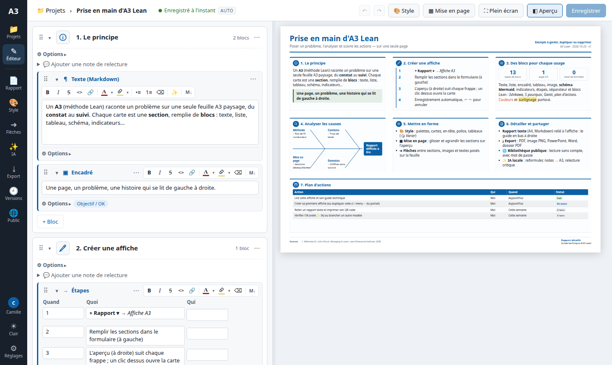
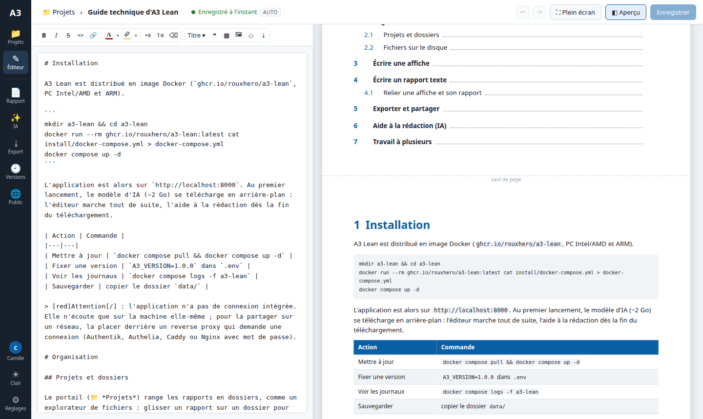
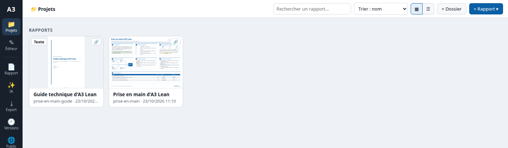

# A3 Lean

**Éditeur web de rapports A3 (méthode Lean) et de rapports techniques**, à installer chez soi avec Docker.
Une affiche A3 pour la synthèse, un rapport texte de plusieurs pages pour le détail, reliés par un lien et un QR code.
Aide à la rédaction par une IA locale, sans envoyer vos textes ailleurs.

*Web editor for Lean A3 reports and linked technical reports, self-hosted with Docker. The interface is in French.*



## Ce que fait A3 Lean

- **Affiches A3** : une feuille A3 paysage en sections, remplie de blocs — texte, listes, tableaux, schémas Mermaid, images, indicateurs, étapes, et blocs Lean (Ishikawa, 5 pourquoi, Gantt, plan d'actions). Aperçu en direct, mise en page à la souris, flèches entre sections, palettes et styles.
- **Rapports texte** : un document A4 en Markdown, avec page de garde, sommaire et titres numérotés, relié à son affiche. L'affiche peut imprimer un **QR code** vers le rapport.
- **Exports** : PDF (A3 ou A4 avec sommaire paginé), image PNG, PowerPoint, Word, et un PDF « dossier » affiche + rapport.
- **Partage** : lien de lecture, bibliothèque publique protégée par un mot de passe (avec journal des accès).
- **IA locale** (Ollama, facultative) : reformuler un texte, transformer des notes en affiche, traduire, relecture critique façon coach Lean ; dans les rapports texte, menu IA au clic droit (développer, raccourcir, continuer, traduire, consigne libre…) et suggestion de la suite au curseur (Ctrl+Espace, Tab pour accepter).
- **Travail à plusieurs** : historique des versions, présence, conflits d'enregistrement sans perte, notes de relecture.
- **Vos données restent des fichiers** : une affiche = un fichier `.yaml`, un rapport = un fichier `.md`, dans un dossier que vous sauvegardez comme vous voulez. Pas de base de données, fonctionne hors ligne.

| Rapport texte (A4) | Portail des projets |
|---|---|
|  |  |

## Installer

Il faut [Docker](https://docs.docker.com/get-docker/) avec Compose (PC Linux, Windows ou Mac ; processeur Intel/AMD ou ARM, dont Raspberry Pi 4/5 en 64 bits et Mac M*). Prévoir ~4 Go de RAM libre avec l'IA, ~1 Go sans.

```bash
mkdir a3-lean && cd a3-lean
curl -fsSLO https://raw.githubusercontent.com/Rouxhero/a3-lean-install/main/docker-compose.yml
docker compose up -d
```

Puis ouvrir **http://localhost:8000**. Deux exemples reliés vous attendent : l'affiche *Prise en main d'A3 Lean* et son *Guide technique*.

Au premier lancement, le modèle d'IA (`qwen2.5:3b`, ~2 Go) se télécharge en arrière-plan : l'éditeur marche tout de suite, l'aide à la rédaction dès la fin du téléchargement (`docker compose logs -f ollama-pull`).

## Régler

Copier [`.env.example`](.env.example) en `.env` à côté de `docker-compose.yml`, décommenter ce qu'il faut changer, puis `docker compose up -d` :

| Réglage | Exemple |
|---|---|
| Port | `A3_PORT=8080` |
| Nom de l'auteur (versions, notes) | `A3_AUTEUR=Camille` |
| Modèle Ollama plus gros (meilleurs textes, plus de RAM) | `A3_LLM_MODEL=qwen2.5:7b` |
| Autre serveur compatible OpenAI (OpenAI, LM Studio…) | `A3_LLM_URL`, `A3_LLM_MODEL`, `A3_LLM_API_KEY` |
| Version fixe | `A3_VERSION=1.1.0` |
| Couper l'accès des outils IA externes (`/mcp`) | `A3_MCP=0` |

**Sans IA** : supprimer les services `ollama` et `ollama-pull` (et la ligne `depends_on`) dans `docker-compose.yml`. Le reste de l'application fonctionne normalement.

## Mettre à jour, sauvegarder

```bash
docker compose pull && docker compose up -d     # dernière version
```

Tout est dans le dossier `data/` (rapports, images, versions) : c'est lui qu'il faut sauvegarder. La version installée s'affiche dans *Réglages*. Les versions publiées : [ghcr.io/rouxhero/a3-lean](https://github.com/users/Rouxhero/packages/container/package/a3-lean).

## Travailler à plusieurs : comptes et partage

Par défaut (`A3_AUTH=aucune`), A3 Lean n'a pas de connexion : une seule personne, et le `docker-compose.yml` ne l'expose **que sur la machine elle-même** (`127.0.0.1`).

Avec `A3_AUTH=connexion` (fichier `.env`, voir `.env.example`), une page de connexion protège tout :

- **Code par e-mail** : la personne saisit son adresse et reçoit un code à 6 chiffres (valable 10 minutes). Réglages d'envoi (SMTP) dans `.env` ou dans l'appli, volet *Admin* (avec un bouton d'e-mail de test). Sans SMTP, le code est écrit dans les journaux (`docker compose logs a3-lean`) : pratique pour le premier compte.
- **SSO OpenID Connect** (Authentik, Keycloak, Google…) : bouton « Se connecter avec … ». Créer chez le fournisseur une application OAuth2/OpenID (client confidentiel) avec la redirection `<adresse publique>/auth/oidc/retour`, puis renseigner l'émetteur, le client ID et le secret.
- **Administrateurs** : `A3_ADMINS` (e-mails), sinon le premier compte créé. Volet *Admin* : SMTP, SSO, qui peut créer un compte (sur invitation, certains domaines, ou toute adresse), liste des comptes (droits d'administration, blocage).
- **Partage** : chaque personne ne voit que ses dossiers et rapports, et ce qu'on lui partage. Menu `⋯` → *Partager…* (ou dans l'éditeur) : ajouter une adresse e-mail en *Lecture* ou *Modification* ; partager un dossier donne accès à tout son contenu. L'invitée reçoit un e-mail et se connecte avec cette adresse.
- Les rapports créés avant d'activer la connexion appartiennent aux administrateurs.
- Ancien fonctionnement derrière un proxy à « forward auth » qui pose `X-authentik-username` / `X-authentik-name` / `X-authentik-email` : `A3_TRUST_PROXY_HEADERS=1` (ne l'activer que si le conteneur n'est joignable que par ce proxy).

Seule la bibliothèque publique (préfixe `/p/`) est faite pour être ouverte sans compte : elle a son propre mot de passe, ne permet que la lecture des rapports que vous y mettez, et note chaque visite.

De même, l'adresse `/mcp` (outils IA externes : GitHub Copilot dans VS Code, Claude…) peut passer sans la connexion du proxy : A3 Lean y exige un jeton personnel, créé dans *Réglages*. Si vous ne vous en servez pas, désactivez-la avec `A3_MCP=0`.

## Licence

[MIT](LICENSE). Ce dépôt ne contient que de quoi installer l'application : l'image Docker est construite et publiée automatiquement à chaque version.
